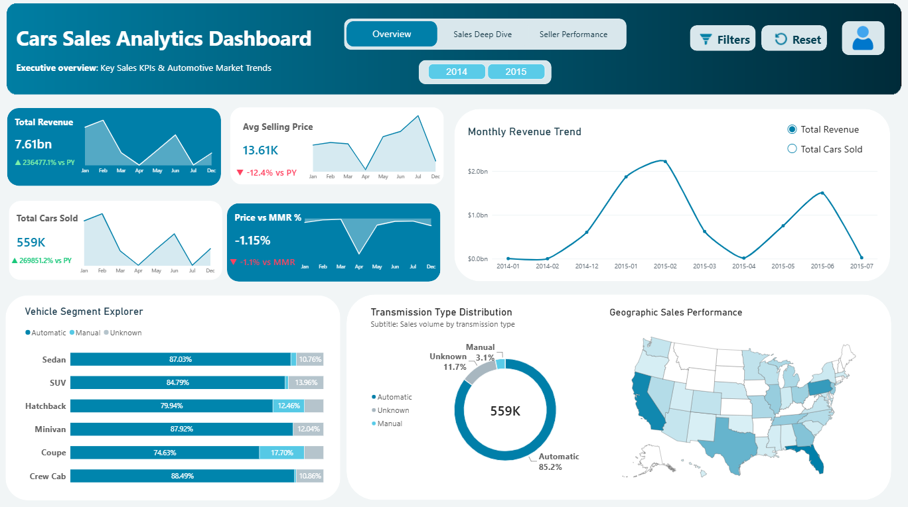
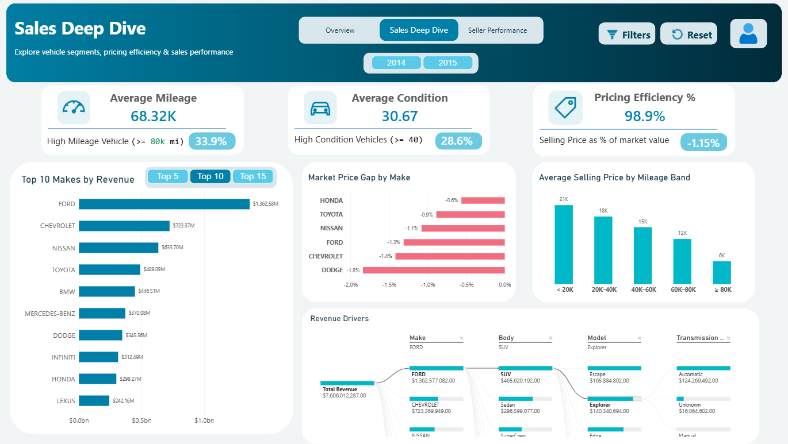
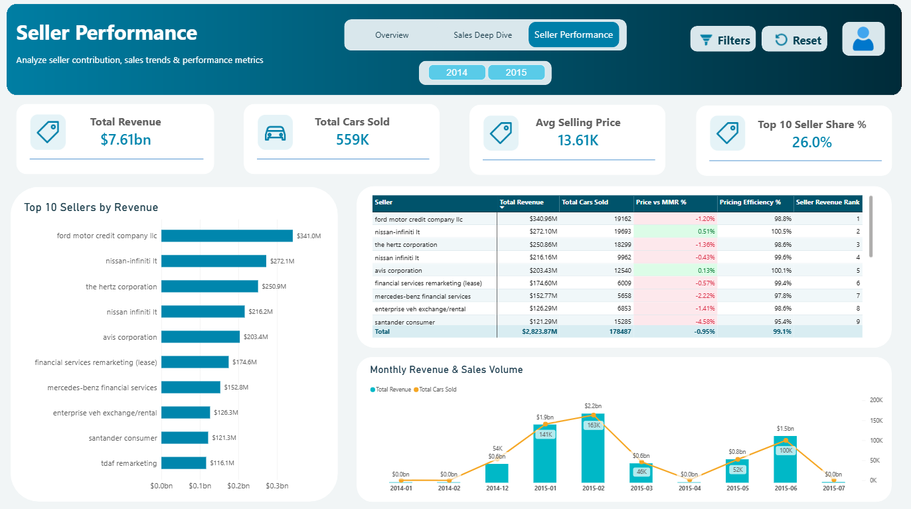
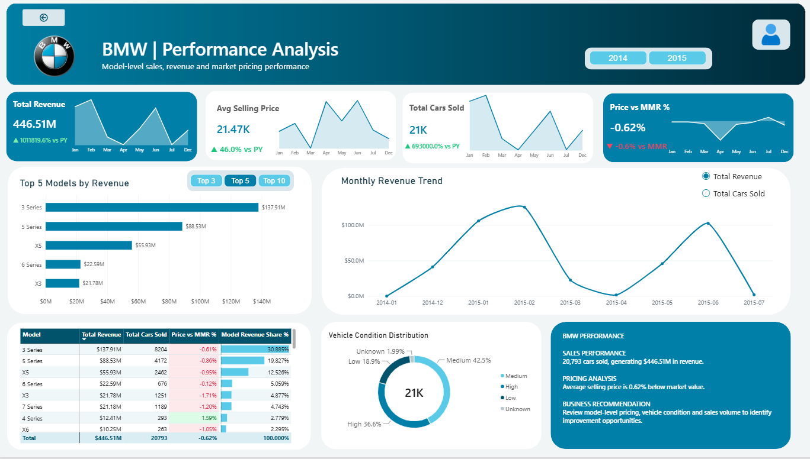
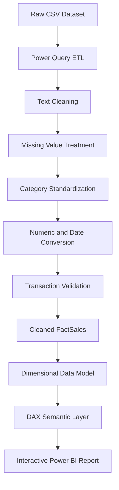
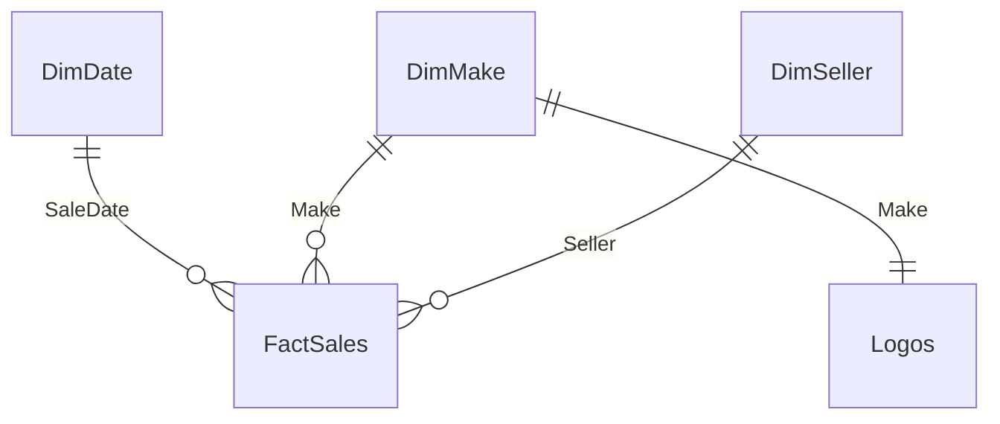

# Car Sales Analytics Dashboard | Power BI

**Transforming 559K automotive sales transactions into actionable business intelligence.**

An end-to-end Business Intelligence solution built in Microsoft Power BI to analyze $7.61 billion in automotive sales revenue across the US market (2014–2015).

The project integrates custom Power Query ETL, dimensional data modeling, 57 DAX measures, and interactive reporting to evaluate sales performance, market pricing, manufacturer rankings, and seller revenue concentration.


## 🚀 Explore the Live Dashboard

**[▶ Launch Interactive Power BI Dashboard ↗](https://app.powerbi.com/view?r=eyJrIjoiYzIzMzU1ZDYtOGI3My00YzhhLTkxYTQtY2I0MmQ4Yjc3NDM5IiwidCI6ImFhYjAwYjAxLTIwOWYtNGU4YS05Mzc2LWRkNGNkODlhNDNjMSJ9)**

Explore $7.61B in automotive sales across 559K transactions.
Apply filters, switch metrics, explore dynamic rankings,
and drill down into manufacturer-level performance.

[](https://app.powerbi.com/view?r=eyJrIjoiYzIzMzU1ZDYtOGI3My00YzhhLTkxYTQtY2I0MmQ4Yjc3NDM5IiwidCI6ImFhYjAwYjAxLTIwOWYtNGU4YS05Mzc2LWRkNGNkODlhNDNjMSJ9)

<p align="center">
  <b>↑ Click the dashboard preview to open the interactive report</b>
</p>

<p align="center">
  ✓ No installation required &nbsp; | &nbsp;
  ✓ No sign-in required &nbsp; | &nbsp;
  ✓ Fully interactive
</p>

---

---

## Table of Contents

- [Business Problem](#business-problem)
- [Key Metrics](#key-metrics)
- [Key Business Insights](#key-business-insights)
- [Dashboard Architecture](#dashboard-architecture)
- [Dataset](#dataset)
- [Data Cleaning and ETL](#data-cleaning-and-etl)
- [Data Model](#data-model)
- [DAX Implementation](#dax-implementation)
- [Interactive Features](#interactive-features)
- [Analytical Limitations](#analytical-limitations)
- [Project Structure](#project-structure)
- [Getting Started](#getting-started)
- [Skills Demonstrated](#skills-demonstrated)

---

## Business Problem

Raw automotive transaction data provides detailed information about vehicle sales, market reference prices, manufacturers, and sellers. However, without a structured analytical model, identifying revenue drivers, evaluating pricing performance, and comparing business segments becomes inefficient.

**Objective:** Build a centralized analytical solution that supports executive reporting, operational analysis, and data-driven decision-making.

| Business Challenge | Analytical Solution |
|---|---|
| Inconsistent and incomplete transaction data | Custom Power Query ETL pipeline |
| Limited visibility into sales performance | Centralized KPIs and time intelligence |
| Difficulty comparing manufacturers and models | Dynamic Top N rankings and drill-through |
| Unclear pricing performance | Selling price vs. MMR benchmark analysis |
| Limited understanding of revenue drivers | Multi-dimensional decomposition analysis |
| Seller performance and concentration risks | Seller benchmarking and revenue contribution metrics |

---

## Key Metrics

| Metric | Value |
|---|---:|
| Total Revenue | $7.61B |
| Total Cars Sold | ~559,000 |
| Average Selling Price | $13,610 |
| Price vs. Market Reference (MMR) | -1.15% |
| Pricing Efficiency | 98.9% |
| Average Mileage | 68,320 mi |
| Average Condition Score | 30.67 |
| High Mileage Vehicles (80K+ mi) | 33.9% |
| High Condition Vehicles (Score ≥ 40) | 28.6% |
| Top 10 Seller Revenue Share | 26.0% |

---

## Key Business Insights

### 1. Manufacturer Revenue Concentration

Ford leads the dataset with $1.36B in revenue, followed by Chevrolet ($723.37M) and Nissan ($633.70M). Together, these three manufacturers account for approximately 35.8% of total recorded revenue.

**Business implication:** Manufacturer-level segmentation is essential for identifying the largest revenue contributors and prioritizing performance analysis.

### 2. Market Pricing Performance

Overall selling prices are 1.15% below the aggregate MMR benchmark. Among the manufacturers displayed in the pricing comparison, Dodge has the largest negative deviation (-1.8%), while Honda is closest to its benchmark (-0.6%).

**Business implication:** Manufacturer-specific pricing reviews can help identify potential opportunities for improving price realization.

### 3. Mileage and Selling Price

| Mileage Band | Average Selling Price |
|---|---:|
| Below 20K miles | $21K |
| 20K–40K miles | $18K |
| 40K–60K miles | $15K |
| 60K–80K miles | $12K |
| 80K+ miles | $6K |

Vehicles with 80K+ miles have an average selling price approximately 71% lower than vehicles below 20K miles.

**Business implication:** Mileage is an important segmentation variable for vehicle pricing and inventory evaluation, although other vehicle characteristics must also be considered.

### 4. Sales Trends and Vehicle Distribution

- February 2015 recorded the highest observed monthly revenue ($2.2B) and sales volume (163K vehicles).
- Automatic transmission accounts for 85.2% of total sales volume, followed by unknown (11.7%) and manual (3.1%).

### 5. Seller Revenue Concentration

The top 10 seller records contribute 26% of total revenue. Ford Motor Credit Company LLC ranks first with $340.96M in recorded sales.

**Business implication:** Revenue concentration metrics provide a starting point for evaluating seller dependency and benchmarking seller performance.

### 6. Manufacturer-Level Drill-through: BMW

BMW generated $446.51M from 20,793 vehicle transactions, with an average selling price of $21.47K.

The 3 Series and 5 Series together contribute approximately 50.7% of BMW's revenue, while overall BMW selling prices are 0.62% below the MMR benchmark.

This demonstrates how executive-level findings can be investigated at manufacturer and model granularity.

---

## Dashboard Architecture

The report consists of three main analytical pages, one dedicated drill-through page, and two supporting tooltip pages.

### Page 1 — Executive Overview


**Objective:** Monitor overall sales performance and identify major market patterns.

| Visual | Analytical Purpose |
|---|---|
| KPI Cards with Sparklines | Revenue, sales volume, average price, and market pricing |
| Monthly Revenue Trend | Identify changes in sales performance over time |
| Vehicle Segment Explorer | Compare transmission distribution across body types |
| Transmission Distribution | Evaluate vehicle sales composition |
| Geographic Shape Map | Compare state-level sales performance |

A field parameter enables dynamic switching between revenue and sales volume within the trend visual.

---

### Page 2 — Sales Deep Dive



**Objective:** Investigate vehicle characteristics, manufacturer performance, and market pricing.

| Visual | Analytical Purpose |
|---|---|
| Vehicle Performance KPIs | Mileage, condition, and pricing efficiency |
| Dynamic Top N Manufacturers | Compare the leading 5, 10, or 15 manufacturers |
| Market Price Gap by Make | Identify deviations from market reference values |
| Selling Price by Mileage Band | Evaluate pricing across mileage segments |
| Revenue Decomposition Tree | Explore revenue by make, body, model, and transmission |

The decomposition tree enables multi-dimensional analysis without requiring separate visuals for every possible category combination.

---

### Page 3 — Seller Performance



**Objective:** Evaluate seller contributions, pricing performance, and revenue concentration.

| Visual | Analytical Purpose |
|---|---|
| Seller Performance KPIs | Revenue, sales volume, average price, and concentration |
| Top 10 Sellers | Identify the largest revenue contributors |
| Seller Performance Matrix | Compare revenue, volume, pricing efficiency, and rank |
| Monthly Revenue and Sales Volume | Evaluate transaction value and volume together |

Conditional formatting highlights positive and negative deviations from market reference prices.

---

### Page 4 — Make Performance (Drill-through)



**Objective:** Move from manufacturer-level comparisons to detailed model-level analysis.

| Feature | Analytical Purpose |
|---|---|
| Dynamic Manufacturer Logo and Title | Reflect the selected manufacturer |
| Manufacturer-Specific KPIs | Evaluate revenue, volume, and pricing |
| Dynamic Top 3/5/10 Models | Identify leading vehicle models |
| Monthly Performance Trend | Track manufacturer performance over time |
| Model Performance Matrix | Compare revenue, sales, pricing, and contribution |
| Vehicle Condition Distribution | Analyze the condition profile of sold vehicles |
| Dynamic Business Insight Text | Summarize selected manufacturer performance |

Drill-through transfers manufacturer context from the main report to the detailed analytical page.

---

## Dataset

The original CSV dataset contains 16 fields describing automotive sales transactions.

| Data Category | Fields |
|---|---|
| Vehicle Identification | VIN, manufacturing year, make, model, trim |
| Vehicle Characteristics | Body, transmission, color, interior |
| Vehicle Quality | Condition, odometer |
| Transaction Information | Selling price, sale date |
| Market Benchmark | MMR |
| Business Dimensions | State, seller |

**Granularity:** One row represents one recorded vehicle sales transaction.

**MMR (Manheim Market Report):** A vehicle market reference value used to benchmark actual selling prices.

The dataset covers historical transactions recorded during 2014–2015.

---

## Data Cleaning and ETL

A custom Power Query transformation pipeline was implemented using M Language to improve data consistency, handle invalid values, and prepare the dataset for dimensional modeling.

### ETL Architecture



### Transformation Pipeline

| Step | Operation | Implementation |
|---|---|---|
| 1 | Data ingestion | Csv.Document and Table.PromoteHeaders |
| 2 | Text cleaning | Text.Trim and Text.Clean |
| 3 | Missing value treatment | Null and empty categories replaced with UNKNOWN |
| 4 | Placeholder standardization | Invalid color and interior placeholders replaced |
| 5 | Category normalization | Text.Upper applied to make, state, and VIN |
| 6 | Numeric conversion | Int64.From with try...otherwise |
| 7 | Date parsing | Date.FromText with explicit format and culture |
| 8 | Data validation | Invalid dates and non-positive selling prices flagged |
| 9 | Final dataset preparation | Invalid transactions and temporary columns removed |

### Safe Numeric Conversion

```powerquery
each try Int64.From(_) otherwise null
```

Prevents invalid numeric values from interrupting the transformation pipeline.

### Transaction Validation

```powerquery
each
    if [SaleDate] = null then "Invalid Date"
    else if [sellingprice] = null or [sellingprice] <= 0
        then "Invalid Price"
    else "Valid"
```

Only transactions classified as valid are retained in the final fact table.

### Feature Engineering

Additional analytical attributes were developed to support vehicle segmentation:

- Vehicle age and age groups
- Mileage bands
- Vehicle condition categories
- Transmission categories
- Geographic attributes

---

## Data Model

The semantic model contains 11 tables organized into transactional, dimensional, lookup, measure, and analytical selector layers.

### Core Model Architecture

| Table | Type | Purpose |
|---|---|---|
| FactSales | Fact | Cleaned transaction-level automotive sales |
| DimDate | Dimension | Calendar attributes and time intelligence |
| DimMake | Dimension | Manufacturer-level filtering |
| DimSeller | Dimension | Seller-level filtering |
| Logos | Lookup | Manufacturer-specific images |
| AllMeasure | Measure table | Centralized business calculations |

### Entity Relationships



The central fact table is connected to the date, manufacturer, and seller dimensions through one-to-many relationships.

The manufacturer logo lookup uses a one-to-one relationship with bidirectional filtering.

### Analytical Control Tables

| Table | Application |
|---|---|
| Sales Metric Selector | Revenue and sales volume switching |
| Top N Selection | Dynamic model rankings |
| Top N Makes | Dynamic manufacturer rankings |
| Vehicle Segment Selector | Interactive vehicle segmentation |
| Seller Share Group | Seller contribution analysis |

The dedicated date dimension supports consistent time-based filtering and previous-period comparisons.

---

## DAX Implementation

The semantic model contains 57 explicit DAX measures covering business KPIs, time intelligence, dynamic rankings, revenue contribution, conditional formatting, and interactive report behavior.

### 1. Base Measures

```dax
Total Revenue =
SUM(FactSales[sellingprice])
```

```dax
Total Cars Sold =
COUNTROWS(FactSales)
```

These measures provide reusable foundations for more complex analytical calculations.

### 2. Time Intelligence

```dax
PY Revenue =
CALCULATE(
    [Total Revenue],
    SAMEPERIODLASTYEAR('DimDate'[Date])
)
```

```dax
Revenue YoY % =
VAR CurrentRevenue = [Total Revenue]
VAR PreviousRevenue = [PY Revenue]
RETURN
IF(
    ISBLANK(PreviousRevenue) ||
    PreviousRevenue = 0,
    BLANK(),
    DIVIDE(
        CurrentRevenue - PreviousRevenue,
        PreviousRevenue
    )
)
```

**Purpose:** Compare revenue against the corresponding previous-year period while handling missing or zero comparison values.

### 3. Market Pricing Deviation

```dax
Price vs MMR % =
DIVIDE(
    SUM(FactSales[sellingprice]) -
    SUM(FactSales[mmr]),
    SUM(FactSales[mmr])
)
```

| Result | Interpretation |
|---|---|
| Positive | Aggregate selling prices exceed MMR |
| Zero | Aggregate selling prices match MMR |
| Negative | Aggregate selling prices are below MMR |

The calculation uses aggregate values rather than averaging individual transaction-level percentage differences.

### 4. Pricing Efficiency

```dax
Pricing Efficiency % =
DIVIDE(
    [Avg Selling Price],
    [Average MMR]
)
```

**Purpose:** Evaluate the average selling price relative to the average market reference value.

### 5. Model Revenue Contribution

```dax
Model Revenue Share % =
DIVIDE(
    [Total Revenue],
    CALCULATE(
        [Total Revenue],
        ALLSELECTED(FactSales[model])
    )
)
```

**Purpose:** Calculate model-level revenue contribution within the selected analytical context.

ALLSELECTED removes the current model grouping while retaining external report selections.

### 6. Seller Revenue Concentration

```dax
Top 10 Seller Share % =
VAR TopSellers =
    TOPN(
        10,
        ALLSELECTED(DimSeller[Seller]),
        [Total Revenue],
        DESC
    )
VAR TopRevenue =
    CALCULATE(
        [Total Revenue],
        KEEPFILTERS(TopSellers)
    )
VAR AllRevenue =
    CALCULATE(
        [Total Revenue],
        ALLSELECTED(DimSeller[Seller])
    )
RETURN
    DIVIDE(TopRevenue, AllRevenue, 0)
```

**Purpose:** Measure the revenue contribution of the leading sellers relative to the selected seller population.

This calculation combines dynamic ranking, virtual tables, and filter context management.

### DAX Techniques Applied

| Technique | Application |
|---|---|
| CALCULATE | Filter context modification |
| ALLSELECTED | Dynamic contribution analysis |
| KEEPFILTERS | Preserve and intersect filter conditions |
| TOPN | Dynamic seller and category selection |
| RANKX | Performance rankings |
| VAR / RETURN | Structured calculation logic |
| DIVIDE | Safe ratio calculations |
| SAMEPERIODLASTYEAR | Historical performance comparison |

---

## Interactive Features

The report was designed with application-style navigation and context-aware analytical interactions.

| Feature | Implementation |
|---|---|
| Page Navigation | Navigation between three main analytical pages |
| Bookmarks | Expandable filter panels |
| Reset Filters | Restore predefined filter states |
| Drill-through | Manufacturer-specific detailed reporting |
| Field Parameters | Dynamic metric and dimension switching |
| Dynamic Top N | User-controlled manufacturer and model rankings |
| Custom Tooltips | Additional contextual information |
| Conditional Formatting | Performance-based KPI and matrix formatting |
| Dynamic Titles and Logos | Context-aware manufacturer identification |
| Chiclet Slicer | Custom year and selection controls |
| Decomposition Tree | Multi-dimensional revenue exploration |
| Shape Map | Geographic sales analysis |

---

## Analytical Limitations

- **Revenue vs. profit:** Revenue represents recorded vehicle selling prices. Acquisition costs are unavailable, so actual profit and profit margin cannot be calculated.
- **Market benchmark:** MMR is a reference value, not the acquisition cost of a vehicle.
- **Historical coverage:** Transaction coverage is uneven across 2014–2015. YoY growth percentages may be distorted by incomplete comparison periods.
- **Seller normalization:** Similar seller names may represent the same organization. Additional entity resolution is required for consolidated seller-level reporting.
- **Missing benchmark values:** MMR availability should be validated before using pricing metrics for operational decisions.
- **Transaction granularity:** Cars sold represents transaction rows rather than distinct VINs.
- **Correlation vs. causation:** Mileage-based pricing differences are descriptive and do not isolate the effects of vehicle age, condition, or manufacturer.

---

## Project Structure

```text
Car-Sales-Analytics-PowerBI/
│
├── README.md
├── CarSales.pbix
│
└── images/
    ├── overview.png
    ├── sales-deep-dive.png
    ├── seller-performance.png
    └── make-performance.png
```

| File | Description |
|---|---|
| CarSales.pbix | Power BI report, semantic model, and transformation logic |
| images/ | Screenshots of all four analytical pages |
| README.md | Technical documentation and business insights |

---

## Getting Started

### Prerequisites

- Microsoft Power BI Desktop

### Explore the Dashboard

1. Download [CarSales.pbix](CarSales.pbix).
2. Open the report in Power BI Desktop.
3. Navigate between the Overview, Sales Deep Dive, and Seller Performance pages.
4. Use the filters, metric selectors, and dynamic Top N controls.
5. Right-click a manufacturer and select Drill-through to explore model-level performance.

### Refresh the Dataset

The original CSV dataset is not included in this repository because its size exceeds GitHub's browser upload limit.

To refresh the report from the original source:

1. Obtain the original car_prices.csv dataset.
2. Open Transform Data in Power BI Desktop.
3. Update the CSV source path in Power Query.
4. Select Close & Apply and refresh the report.

The saved PBIX report can be explored using its imported data without reconnecting to the original CSV, provided the imported data is retained in the published file.

---

## Skills Demonstrated

| Competency | Project Implementation |
|---|---|
| Data Preparation | Custom M Language transformations and validation |
| ETL Development | Structured, reusable data cleaning pipeline |
| Dimensional Modeling | 11-table semantic model with fact and dimension relationships |
| DAX Development | 57 explicit measures and reusable calculation logic |
| Time Intelligence | Previous-period and growth calculations |
| Filter Context Management | CALCULATE, ALLSELECTED, and KEEPFILTERS |
| Business Analytics | Pricing, sales performance, and revenue concentration |
| Data Visualization | Business-oriented visual selection |
| Dashboard Engineering | Bookmarks, drill-through, field parameters, and navigation |
| Data Storytelling | Executive reporting supported by detailed analytical insights |

---

## Roadmap

- Parameterize the CSV source path for easier deployment.
- Implement seller entity resolution and additional data quality checks.
- Integrate SQL Server as a centralized data source.
- Introduce automated refresh and data quality monitoring through Power BI Service.

---

## Author

**Javohir Yunusov**

Data Analyst | SQL · Python · Power BI

[LinkedIn](https://www.linkedin.com/in/javohir-yunusov-705424295) · [Telegram](https://t.me/yunusovv66)

> Developed as an academic final project and professional Business Intelligence portfolio project, demonstrating the complete workflow from raw data preparation to business performance analysis.
