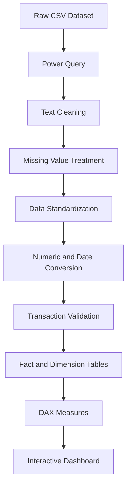
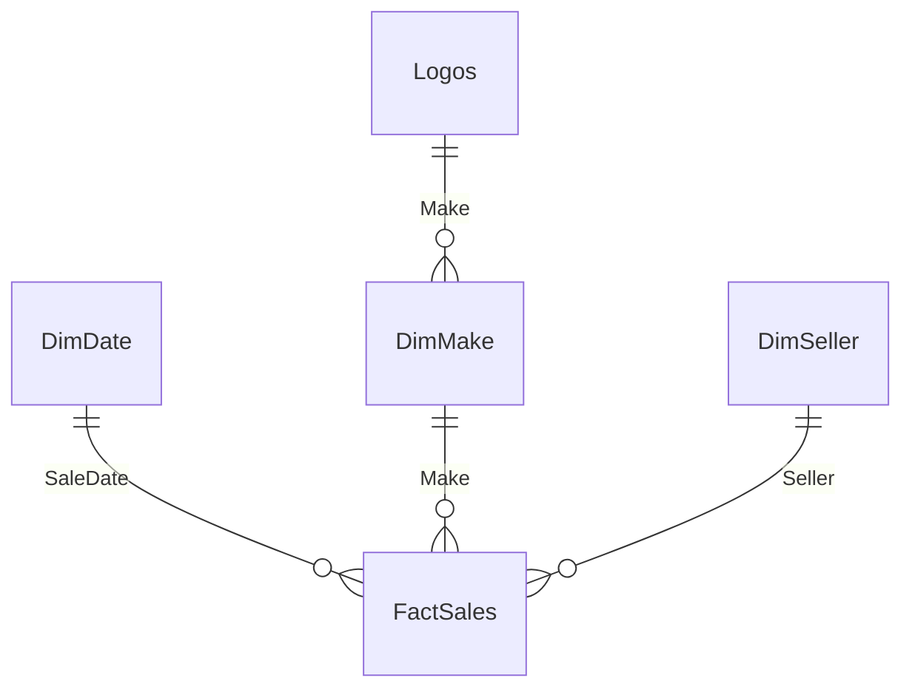

# Car Sales Analytics Dashboard | Power BI

**From raw automotive transactions to data-driven sales, pricing, and seller performance analysis.**

An end-to-end Business Intelligence project built in Microsoft Power BI, covering data cleaning with Power Query and M Language, dimensional data modeling, 57 DAX measures, and interactive business performance reporting.


---

## Table of Contents

- [Business Problem](#business-problem)
- [Dataset](#dataset)
- [Data Cleaning and Transformation](#data-cleaning-and-transformation)
- [Data Model](#data-model)
- [Key Performance Indicators](#key-performance-indicators)
- [Dashboard Preview](#dashboard-preview)
- [DAX Implementation](#dax-implementation)
- [Interactive Features](#interactive-features)
- [Business Applications](#business-applications)
- [Project Structure](#project-structure)
- [Getting Started](#getting-started)
- [Skills Demonstrated](#skills-demonstrated)
- [Author](#author)

---

## Business Problem

Automotive sales data contains detailed transaction records, vehicle characteristics, market reference prices, and seller information. However, raw transaction data makes it difficult to evaluate performance across manufacturers, models, geographic markets, and sellers.

The project was developed to answer six key business questions:

1. How are revenue and vehicle sales changing over time?
2. Which manufacturers and models contribute most to total revenue?
3. Which states generate the strongest sales performance?
4. Are vehicles being sold above or below their market reference value?
5. How do mileage and vehicle condition relate to sales and pricing performance?
6. How dependent is total revenue on the top-performing sellers?

### Problem and Analytical Solution

| Business Problem | Implemented Solution |
|---|---|
| Inconsistent and missing data | Automated Power Query cleaning pipeline |
| Difficult revenue and sales tracking | Centralized KPIs and time intelligence |
| Limited manufacturer comparison | Dynamic Top N rankings and drill-through |
| Unclear market pricing performance | Selling price vs. MMR analysis |
| Limited seller visibility | Seller ranking and revenue contribution analysis |
| Static reporting | Interactive filters, bookmarks, and field parameters |

---

## Dataset

The project uses a CSV dataset containing vehicle-level automotive sales transactions.

The original dataset consists of 16 columns.

| Field | Description |
|---|---|
| year | Vehicle manufacturing year |
| make | Vehicle manufacturer |
| model | Vehicle model |
| trim | Vehicle trim level |
| body | Vehicle body type |
| transmission | Transmission type |
| vin | Vehicle identification number |
| state | Geographic market |
| condition | Vehicle condition score |
| odometer | Vehicle mileage |
| color | Exterior color |
| interior | Interior color |
| seller | Vehicle seller |
| mmr | Manheim Market Report reference value |
| sellingprice | Actual vehicle selling price |
| saledate | Transaction date |

**MMR (Manheim Market Report)** is used as a market reference value to evaluate how actual selling prices compare with estimated vehicle market prices.

The analysis focuses on transaction revenue, sales volume, market pricing, vehicle characteristics, and seller performance.

---

## Data Cleaning and Transformation

Data preparation was performed in Power Query using a custom M Language transformation pipeline rather than relying exclusively on manual cleaning operations.

### ETL Workflow



### Cleaning Operations

| Step | Data Quality Issue | Implemented Transformation |
|---|---|---|
| 1 | Raw CSV structure | Imported data and promoted column headers |
| 2 | Unnecessary spaces and non-printable characters | Text.Trim and Text.Clean |
| 3 | Missing categorical values | Replaced null and empty values with UNKNOWN |
| 4 | Invalid color and interior placeholders | Standardized dash characters to UNKNOWN |
| 5 | Inconsistent manufacturer names and codes | Applied Text.Upper to make, state, and VIN |
| 6 | Invalid numeric values | Safe conversion using try...otherwise |
| 7 | Unstructured transaction dates | Parsed sale dates using Date.FromText |
| 8 | Invalid transaction records | Excluded missing dates and non-positive selling prices |
| 9 | Temporary validation fields | Removed raw date and validation columns |

### Example: Safe Numeric Conversion

```powerquery
each try Int64.From(_) otherwise null
```

This transformation prevents invalid numeric values from interrupting the data refresh process.

### Example: Transaction Validation

```powerquery
each
    if [SaleDate] = null then "Invalid Date"
    else if [sellingprice] = null or [sellingprice] <= 0
        then "Invalid Price"
    else "Valid"
```

Only transactions classified as valid are retained in the final fact table.

### Feature Engineering

Additional analytical attributes support vehicle segmentation and geographic analysis:

- Vehicle age and age groups
- Mileage bands
- Vehicle condition categories
- Transmission categories
- State-level geographic attributes

These attributes enable comparisons across vehicle segments without modifying the original transaction-level granularity.

---

## Data Model

The semantic model follows a fact-and-dimension architecture, separating transactional data from descriptive attributes and analytical controls.

### Core Tables

| Table | Type | Purpose |
|---|---|---|
| FactSales | Fact | Cleaned vehicle sales transactions |
| DimDate | Dimension | Calendar and time intelligence |
| DimMake | Dimension | Manufacturer-level filtering |
| DimSeller | Dimension | Seller-level filtering |
| Logos | Lookup | Dynamic manufacturer logos |
| AllMeasure | Measure table | Centralized DAX calculations |

### Model Relationships



Additional selector tables support dynamic Top N rankings, metric switching, vehicle segmentation, and seller contribution analysis.

The dedicated date dimension enables consistent filtering by year, quarter, month, and weekday, as well as previous-period comparisons.

---

## Key Performance Indicators

The semantic model contains 57 DAX measures covering sales performance, market pricing, time intelligence, dynamic rankings, and interactive report behavior.

### Sales Performance

| KPI | Calculation | Business Purpose |
|---|---|---|
| Total Revenue | SUM of selling prices | Total transaction value |
| Total Cars Sold | COUNTROWS of FactSales | Sales transaction volume |
| Average Selling Price | Average selling price | Average vehicle transaction value |
| Revenue YoY % | Revenue change vs. previous year | Annual sales growth |
| Revenue MoM % | Revenue change vs. previous month | Short-term performance |

### Pricing and Vehicle Performance

| KPI | Business Purpose |
|---|---|
| Average MMR | Average market reference value |
| Price vs. MMR Difference | Absolute deviation from market reference prices |
| Price vs. MMR % | Relative deviation from market reference prices |
| Pricing Efficiency % | Average selling price relative to average MMR |
| Average Mileage | Mileage profile of sold vehicles |
| Average Condition | Condition profile of sold vehicles |
| High Mileage Vehicles % | Proportion of high-mileage transactions |
| High Condition Vehicles % | Proportion of high-condition transactions |

### Manufacturer and Seller Performance

| KPI | Business Purpose |
|---|---|
| Make Revenue Rank | Manufacturer performance ranking |
| Model Revenue Rank | Model-level performance ranking |
| Model Revenue Share % | Model contribution within the selected context |
| Seller Revenue Rank | Seller performance ranking |
| Seller Revenue Share % | Individual seller contribution |
| Top 10 Seller Share % | Revenue concentration among leading sellers |

---

## Dashboard Preview

The report consists of three main analytical pages, one dedicated drill-through page, and supporting tooltip pages.

### Page 1 — Executive Overview


**Business question:** How is the overall automotive sales business performing?

The overview page provides a consolidated view of sales performance, combining high-level KPIs with time-based, geographic, and vehicle category analysis.

| Analysis | Purpose |
|---|---|
| Executive KPI Cards | Monitor revenue, sales volume, and pricing performance |
| Monthly Sales Trend | Identify growth patterns and seasonal changes |
| Sales by State | Compare geographic market performance |
| Transmission Mix | Evaluate sales distribution by transmission |
| Manufacturer Performance | Identify leading automotive brands |
| Year and Category Filters | Compare selected reporting periods and segments |

Dynamic metric switching allows users to explore performance by revenue or sales volume without duplicating visuals.

---

### Page 2 — Sales Deep Dive


**Business question:** Which vehicle characteristics and pricing factors are associated with sales performance?

This page moves beyond executive-level reporting to examine manufacturers, vehicle segments, and market pricing.

| Analysis | Purpose |
|---|---|
| Dynamic Top N Manufacturers | Compare the leading 5, 10, or 15 manufacturers |
| Selling Price vs. MMR | Evaluate transaction prices against market reference values |
| Mileage Analysis | Compare sales and pricing across mileage segments |
| Vehicle Condition Analysis | Examine performance across condition categories |
| Pricing Efficiency | Evaluate selling prices relative to market benchmarks |
| Decomposition Tree | Explore revenue across multiple business dimensions |

The page supports interactive exploration of revenue drivers and vehicle characteristics.

---

### Page 3 — Seller Performance


**Business question:** Which sellers generate the most revenue, and how concentrated is sales performance?

The seller performance page evaluates individual seller contributions and enables benchmarking across the seller network.

| Analysis | Purpose |
|---|---|
| Seller KPI Cards | Monitor seller-related performance indicators |
| Top Seller Analysis | Identify the highest-performing sellers |
| Seller Revenue Ranking | Compare sellers by revenue |
| Revenue Contribution | Measure individual seller contribution |
| Top 10 Seller Share | Evaluate revenue concentration |
| Seller Performance Matrix | Compare detailed seller-level metrics |

Revenue concentration analysis helps assess whether overall sales performance depends heavily on a relatively small group of sellers.

---

### Page 4 — Make Performance (Drill-through)


**Business question:** Which models drive the performance of a selected manufacturer?

The drill-through page provides manufacturer-specific analysis without requiring users to manually configure multiple filters.

Selecting a manufacturer from the main dashboard transfers its filter context to the detailed report.

| Analysis | Purpose |
|---|---|
| Dynamic Manufacturer Logo | Identify the selected manufacturer |
| Manufacturer KPI Cards | Evaluate selected manufacturer performance |
| Monthly Revenue Trend | Track manufacturer performance over time |
| Dynamic Top N Models | Compare the leading 3, 5, or 10 models |
| Model Revenue Share | Measure individual model contribution |
| Model Performance Matrix | Compare revenue, sales volume, contribution, and rank |

The page enables a structured analytical journey from overall sales performance to manufacturer-level and model-level evaluation.

---

## DAX Implementation

The project uses reusable DAX measures rather than relying exclusively on implicit visual aggregations.

### 1. Total Revenue

```dax
Total Revenue =
SUM(FactSales[sellingprice])
```

Aggregates transaction-level selling prices within the current filter context.

### 2. Total Cars Sold

```dax
Total Cars Sold =
COUNTROWS(FactSales)
```

Counts valid sales transactions within the selected reporting context.

### 3. Year-over-Year Revenue Growth

```dax
Revenue YoY % =
VAR CurrentRevenue = [Total Revenue]
VAR PreviousRevenue = [PY Revenue]
RETURN
IF(
    ISBLANK(PreviousRevenue) ||
    PreviousRevenue = 0,
    BLANK(),
    DIVIDE(
        CurrentRevenue - PreviousRevenue,
        PreviousRevenue
    )
)
```

Compares current-period revenue against the corresponding previous-year period.

The measure returns a blank when previous-period revenue is unavailable or zero, preventing misleading growth percentages.

### 4. Market Pricing Deviation

```dax
Price vs MMR % =
DIVIDE(
    SUM(FactSales[sellingprice]) -
    SUM(FactSales[mmr]),
    SUM(FactSales[mmr])
)
```

| Result | Interpretation |
|---|---|
| Positive | Selling prices exceed the market reference value |
| Zero | Selling prices match the market reference value |
| Negative | Selling prices are below the market reference value |

This measure evaluates aggregate pricing deviation rather than averaging individual transaction-level percentage differences.

### 5. Pricing Efficiency

```dax
Pricing Efficiency % =
DIVIDE(
    [Avg Selling Price],
    [Average MMR]
)
```

Measures average selling price relative to average market reference value.

For example, a pricing efficiency of 95% indicates that the average selling price is 5% below the average MMR.

### 6. Model Revenue Contribution

```dax
Model Revenue Share % =
DIVIDE(
    [Total Revenue],
    CALCULATE(
        [Total Revenue],
        ALLSELECTED(FactSales[model])
    )
)
```

Uses ALLSELECTED to calculate model revenue contribution while respecting external report selections.

### 7. Seller Revenue Contribution

```dax
Seller Revenue Share % =
DIVIDE(
    [Total Revenue],
    CALCULATE(
        [Total Revenue],
        ALLSELECTED(DimSeller[Seller])
    ),
    0
)
```

Measures individual seller revenue relative to the selected seller population.

### Additional DAX Techniques

| Technique | Application |
|---|---|
| CALCULATE | Filter context modification |
| ALLSELECTED | Dynamic contribution calculations |
| RANKX | Manufacturer, model, and seller rankings |
| DIVIDE | Safe ratio calculations |
| VAR / RETURN | Readable and reusable calculation logic |
| Time Intelligence | Previous-year and previous-month comparisons |
| Dynamic Measures | Titles, KPI labels, colors, and ranking controls |

---

## Interactive Features

The report was designed to function as an interactive analytical application rather than a static collection of visuals.

| Feature | Implementation |
|---|---|
| Drill-through | Manufacturer-specific detailed analysis |
| Bookmarks | Interactive filter panel visibility |
| Reset Filters | Restore predefined report filter states |
| Page Navigation | Navigation between analytical pages |
| Dynamic Top N | User-controlled manufacturer and model rankings |
| Field Parameters | Dynamic metric and dimension switching |
| Report Page Tooltips | Additional contextual information |
| Conditional Formatting | Performance-based KPI colors and labels |
| Dynamic Titles | Titles responding to report selections |
| Dynamic Images | Manufacturer logos based on filter context |
| Chiclet Slicer | Custom visual for interactive filtering |
| Decomposition Tree | Multi-dimensional revenue exploration |

---

## Business Applications

| Stakeholder | Analytical Application |
|---|---|
| Executive Management | Monitor revenue, sales volume, and growth |
| Sales Management | Compare manufacturer and model performance |
| Pricing Analysts | Evaluate selling prices against market benchmarks |
| Operations Management | Analyze vehicle characteristics and sales distribution |
| Seller Management | Benchmark sellers and evaluate revenue concentration |

The dashboard brings these analytical requirements into a single reporting environment, allowing stakeholders to move from high-level KPIs to detailed transaction-segment analysis.

---

## Analytical Assumptions and Limitations

- Revenue represents the total recorded selling price of vehicles, not net profit.
- MMR is a market reference value, not the acquisition cost of a vehicle.
- Selling price minus MMR should not be interpreted as profit or profit margin.
- Cars sold is calculated from valid transaction rows, not distinct VIN values.
- Previous-period comparisons depend on available historical data.
- Missing or invalid MMR values may affect market pricing comparisons.
- The dataset represents historical transactions and is not connected to a live sales system.

---

## Project Structure

```text
Car-Sales-Analytics-PowerBI/
│
├── README.md
├── CarSales.pbit
│
├── data/
│   └── car_prices.csv
│
└── images/
    ├── overview.png
    ├── sales-deep-dive.png
    ├── seller-performance.png
    └── make-performance.png
```

---

## Getting Started

### Prerequisites

- Microsoft Power BI Desktop
- Original automotive sales CSV dataset

### Run the Project

1. Download or clone this repository.
2. Download the CarSales.pbit template.
3. Open the template using Power BI Desktop.
4. Open Transform Data and update the CSV source path to the local dataset location.
5. Select Close & Apply and refresh the report.
6. Explore the dashboard using filters, metric selectors, and drill-through functionality.

The PBIT template contains the report design, semantic model, Power Query transformations, DAX measures, and interactive report configuration.

The original CSV dataset is required to populate the report.

---

## Skills Demonstrated

| Skill | Project Implementation |
|---|---|
| Data Cleaning | Missing values, invalid records, text standardization |
| ETL Development | Custom Power Query and M Language pipeline |
| Data Modeling | Fact-and-dimension architecture |
| DAX | 57 measures covering KPIs and analytical logic |
| Time Intelligence | YoY and MoM performance comparisons |
| Business Analytics | Sales, pricing, manufacturer, and seller evaluation |
| Data Visualization | Business-oriented chart selection |
| Dashboard UX/UI | Navigation, filters, bookmarks, and dynamic elements |
| Data Storytelling | Executive-to-detailed analytical workflow |
| Documentation | Reproducible project structure and analytical methodology |

---

## Roadmap

Potential future improvements:

- Parameterized CSV source configuration for easier deployment.
- SQL Server integration for centralized data storage.
- Automated refresh through Power BI Service.
- Additional pricing validation and transaction-level data quality monitoring.

---

## Author

**Javohir Yunusov**

Data Analyst | Business Intelligence | SQL | Power BI | Python

[LinkedIn](https://www.linkedin.com/in/javohir-yunusov-705424295) · [Telegram](https://t.me/yunusovv66)

> Academic final project developed as a professional Data Analytics and Business Intelligence portfolio project.
> 
